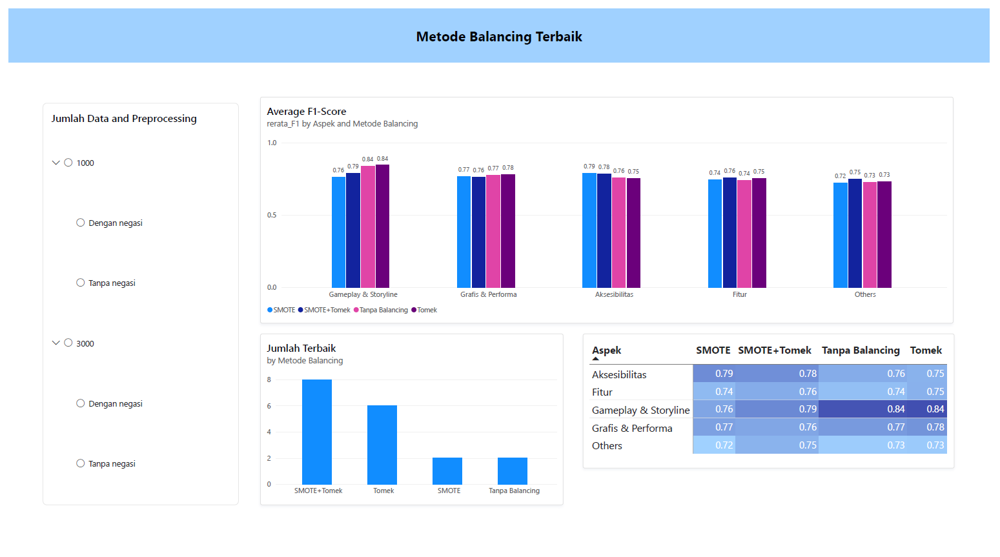
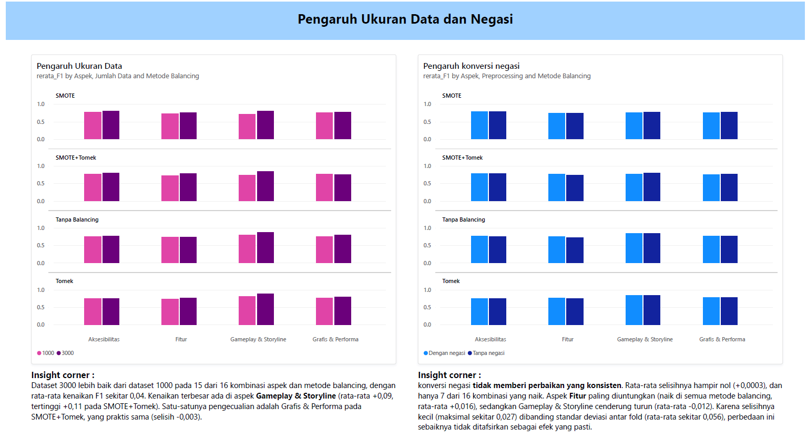

# Genshin-Impact-ABSA-Handling-Imbalanced-Sentiment-Data-with-SMOTE-Tomek
# Aspect-Based Sentiment Analysis Review Game Genshin Impact

Analisis sentimen berbasis aspek (ABSA) pada review Genshin Impact dengan **Multinomial Naive Bayes**, membandingkan **empat strategi penanganan ketidakseimbangan kelas** (tanpa balancing, SMOTE, Tomek Links, SMOTE-Tomek) pada dua ukuran dataset dan dua kondisi praproses (dengan dan tanpa konversi negasi). Hasil eksperimen divisualisasikan dalam dashboard Power BI.

> Proyek ini berasal dari skripsi S1 saya. Repositori ini berisi kode eksperimen, rekap hasil, dan dashboard.



---

## Ringkasan

- **Aspek:** Gameplay & Storyline, Aksesibilitas, Grafis & Performa, Fitur, dan Others.
- **Model:** Multinomial Naive Bayes dengan fitur CountVectorizer.
- **Eksperimen:** 2 ukuran dataset × 2 kondisi negasi × 4 metode balancing, dievaluasi per aspek dengan 10-fold stratified cross-validation (18 kombinasi aspek–skenario, total 72 hasil pengujian).
- **Hasil terbaik:** F1 sekitar **0,88** pada aspek Gameplay & Storyline (dataset 3000).

## Latar belakang

Review game biasanya membahas beberapa hal sekaligus (misalnya cerita bagus tetapi performa buruk), sehingga sentimen keseluruhan tidak cukup informatif. ABSA memisahkan sentimen per aspek. Tantangan utamanya adalah **distribusi kelas yang tidak seimbang** pada tiap aspek.

Penelitian ini menjadikan Perwira & Widiastuti (2024) sebagai pembanding, yang memakai teknik balancing tunggal (Random Over/Under-Sampling). Proyek ini menguji teknik hibrida SMOTE-Tomek dan membandingkannya secara terkontrol dengan SMOTE, Tomek Links, dan tanpa balancing pada data review Genshin Impact.

## Data

| Item | Keterangan |
|---|---|
| Sumber | Review pengguna Genshin Impact dari play store yang diambil oleh peneliti terdahulu pada tanggal 1/07/2021 |
| Dataset | 1000 data (subset hasil penyaringan dari 3054 data mentah) dan 3000 data |
| Label | `1` = sentimen positif, `-1` = sentimen negatif, `0` = aspek tidak disebut |
| Klasifikasi | 2 kelas (positif vs negatif) per aspek; label `0` hanya dipakai untuk menentukan apakah aspek disebut |

## Metode

1. **Praproses:** case folding, normalisasi kata, konversi negasi (dibandingkan dengan dan tanpa), penghapusan stopword (Sastrawi + kamus kustom), stemming.
2. **Ekstraksi fitur:** CountVectorizer dengan n-gram (1, 2), `min_df = 2`, `max_df = 0.95`.
3. **Balancing:** Tanpa Balancing, SMOTE, Tomek Links, SMOTE-Tomek.
4. **Klasifikasi:** Multinomial Naive Bayes, `alpha` ditentukan lewat grid search (0,1 dan 1,0).
5. **Evaluasi:** 10-fold stratified cross-validation; metrik accuracy, precision, recall, F1, dan standar deviasi F1 antar fold.


### Skenario pengujian

| Kode | Jumlah data | Konversi negasi |
|---|---|---|
| S1 | 1000 | Tanpa |
| S2 | 1000 | Dengan |
| S3 | 3000 | Tanpa |
| S4 | 3000 | Dengan |

Aspek Others hanya diuji pada dataset 3000 (S3 dan S4).

## Hasil utama

Angka berikut dihitung dari `results/perbandingan_skenario.xlsx` (sheet *Data Lengkap*), dengan aspek Others dikecualikan pada perbandingan lintas dataset dan negasi agar setara.

**1. Dataset 3000 lebih baik daripada 1000.**
Naik pada 15 dari 16 kombinasi aspek dan metode balancing, dengan rata-rata kenaikan F1 sekitar 0,04. Kenaikan terbesar ada pada Gameplay & Storyline (rata-rata +0,09).

**2. Efek balancing bergantung pada aspek.**
SMOTE menurunkan F1 aspek Gameplay & Storyline di semua skenario (sekitar 0,06 sampai 0,09), tetapi menaikkan F1 aspek Aksesibilitas dan Fitur. SMOTE-Tomek unggul pada aspek Others. Tidak ada satu metode balancing yang terbaik untuk semua aspek.

**3. Konversi negasi tidak konsisten.**
Rata-rata selisihnya hampir nol dan hanya 7 dari 16 kombinasi yang naik. Aspek Fitur paling diuntungkan; Gameplay & Storyline cenderung turun. Selisihnya kecil dibanding standar deviasi antar fold (rata-rata sekitar 0,056), sehingga tidak dapat disimpulkan sebagai efek yang pasti.

**4. Performa tertinggi dan terendah.**
Tertinggi: Gameplay & Storyline, dataset 3000 (F1 sekitar 0,88). Terendah: aspek Aksesibilitas, dataset 1000 tanpa balancing (F1 sekitar 0,74).


## Dashboard Power BI

Dashboard terdiri dari dua halaman:

| Halaman | Pertanyaan yang dijawab |
|---|---|
| 1. Perbandingan metode balancing | Metode balancing mana yang terbaik per aspek? |
| 2. Pengaruh jumlah data dan negasi | Apakah jumlah data dan konversi negasi memengaruhi F1? |



File dashboard: [`dashboard/SMOTE_Tomek_result.pbix`](dashboard/SMOTE_Tomek_result.pbix) (buka dengan Power BI Desktop).

## Struktur repositori

```
absa-genshin-impact/
├── README.md
├── notebooks/        # notebook eksperimen dan rekap hasil
├── results/          # hasil mentah tiap skenario (S1, S2, S3, S4)
├── data/             # perbandingan_skenario.xlsx (rekap hasil gabungan)
├── dashboard/        # file .pbix
└── images/           # screenshot dashboard
```

Folder `results/` berisi keluaran mentah dari tiap skenario pengujian (S1 sampai S4, lihat tabel skenario di atas). Hasil dari keempat skenario ini kemudian digabung di `notebooks/rekap_hasil.ipynb` menjadi `data/perbandingan_skenario.xlsx`, yang menjadi sumber dashboard Power BI.

## Cara menjalankan

```bash
git clone https://github.com/<username>/absa-genshin-impact.git
cd absa-genshin-impact
pip install -r requirements.txt
jupyter notebook notebooks/
```

Library utama: `scikit-learn`, `imbalanced-learn`, `pandas`, `numpy`, `Sastrawi`.


## Keterbatasan

- Selisih antar metode umumnya masih dalam rentang standar deviasi antar fold, jadi perbedaan kecil tidak dianggap signifikan.
- Dataset 1000 dan 3000 berbeda bukan hanya dalam jumlah data, tetapi juga cara pengambilannya.
- Aspek Others dibentuk dengan pendekatan pelabelan residual berbasis leksikon dan hanya diuji pada dataset 3000.
- Klasifikasi hanya dua kelas (positif dan negatif); kelas netral belum dimodelkan.

## Pengembangan lanjutan

- Memecah kategori Others menjadi sub-aspek (audio, karakter, monetisasi, event, komunitas).
- Menambah data terkini dari beberapa platform dan memodelkan kelas netral.
- Membandingkan dengan model lain (misalnya SVM atau model berbasis transformer).

## Penulis

**Rifa Nur Anisa**
LinkedIn: `https://www.linkedin.com/in/rifa-nur-anisa/` · Email: `rifanuranisa11@gmail.com`

## Referensi

- Perwira, R. I. & Widiastuti, “Imbalance Dataset in Aspect-Based Sentiment Analysis on Game Genshin Impact Review,” JURNAL INFOTEL, vol. 16, no. 1, Feb 2024, doi: 10.20895/infotel.v16i1.984.